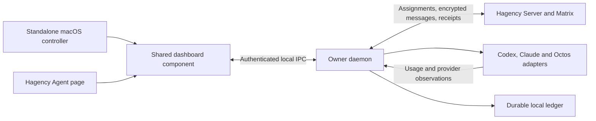

# ADR 0012: Hagency owner daemon and shared control dashboard

- Date: 2026-11-01
- Status: Implemented and built; automated runtime and numerical UX gates passed.
  Manual VoiceOver release acceptance remains open.
- Amended 2026-11-05 by Client ADR-192, "One owner identity per computer"
  (hagency-client `knowledge/decisions/adr-192-one-owner-identity-per-computer.md`):
  Hagency Hosting is folded into Hagency Desktop. The standalone macOS app,
  dashboard handover between hosts and setup launch are removed; the owner
  daemon runs from the Desktop binary, and Desktop's Agent → Hosting page sets
  up, shows, stops and uninstalls hosting. Standalone-controller text below is
  historical.
- Required product direction: independent background hosting, one dashboard
  available standalone and inside Hagency, and iOS-style UX scoring above 95/100.
- Extends [ADR 0009](0009-shared-reloadable-themes.md) for shared themes and
  [ADR 0011](0011-hagency-server-engagements.md) for owner and server authority.
- Scope: Hagency Client runtime, Hagency Desktop/Rinx, and Hagency Server
  telemetry contracts. This record is canonical for this cross-repository change.
- Implementation evidence: [acceptance record](0012-implementation-acceptance.md).

## Problem and original foundation

Before this change, resource owners needed to keep Hagency/Rinx running to host their rented
Agents. A separate window created by that process still shares its lifetime.
Owners also need to understand coding-plan utilization and which rented resources
consume it without keeping the full chat application open.

The original source review used Desktop c984ed91, Client 779bceb5, and Server 98fb33d.
The table records that starting point, rather than the implementation's current
acceptance status. Native accessibility build and test instructions are in the
[owner accessibility guide](../../packaging/owner-accessibility/README.md).

| Existing component | Reuse and remaining work |
| --- | --- |
| Client native/hagency/src/service.rs | Standalone executable, macOS LaunchAgent and Linux user-service installation exist. The installer alone does not provide current desktop pool-hosting parity. |
| [Desktop backend](../../src/hagency/backend.rs) and its allocation/shared workers | Extract worker startup, authentication integration and lifecycle ownership from the desktop. |
| Client native/hagency/src/console/native/managed_runtime/launch.rs | The managed pool launch path currently accepts Codex only. Claude and Octos execution adapters are separate delivery work. |
| Client native/hagency-metering and native/hagency-store/src/domain/usage | Reuse normalized token categories, attribution, receipts and incomplete-usage handling. |
| Server crates/agent-service/src/management_usage.rs | Existing known consumption is a lower bound, not a complete provider-plan ledger. Add detailed telemetry without weakening settlement semantics. |
| [Mini-app surfaces](../../src/miniapps/surface.rs) and [window shell](../../src/miniapps/window.rs) | Reuse navigation and docking concepts. Independent-process handover still needs implementation. |

## Decision

Run a per-user Hagency owner daemon independently of the UI. Build one reusable
dashboard component with a shared view model and daemon client. Mount that
component in a small macOS application and in Hagency's existing Agent page.
Both hosts use the same controls, layouts, commands, state transitions and
telemetry schema. They differ only in window chrome, navigation integration and
the theme supplied by their host.

The diagram describes the target, including Claude/Octos integration that is
not yet available in the current managed pool launcher.

### Component ownership

| Component | Responsibilities |
| --- | --- |
| Owner daemon | Owner enrollment and credential refresh, Matrix sync and Agent crypto stores, allocation workers, execution supervision, permissions, per-room workspaces, usage collection and settlement |
| Shared dashboard | Presentation, navigation, local drafts, commands and subscriptions; no direct ledger writes or execution ownership |
| macOS controller | App bundle and Dock identity, native window/menu lifecycle, daemon discovery, onboarding and local connection |
| Hagency host | Agent navigation, current-user context, theme and access to existing chat/management destinations |
| Server | Existing authorization and allocation authority, owner-scoped remote summaries, receipts and reconciliation |

Use shared Makepad components and the existing theme contract. Extract the
dashboard into a reusable library that does not depend on the Rinx executable,
full room timeline, or its process-global Matrix client. Keep backend work in
Rust. This decision does not require rewriting every existing mini-app screen.

The standalone controller must start and operate while Hagency is closed.
An existing Hagency login may assist explicit enrollment, but neither ongoing
authentication refresh nor future controller startup may require a running Rinx.
Credentials and crypto stores remain in native custody.

### Local control and authority

Use versioned, bounded local IPC with authenticated OS-user identity. Native
management operations additionally use owner/profile-scoped controller leases.
The dashboard's snapshots and Pause/Resume/Stop controls use same-user peer
credentials plus equality with the daemon's single enrolled owner. They do not
issue per-controller leases. This is a one-owner-per-macOS-user trust boundary;
it does not isolate mutually untrusted applications running as that OS user.
A local connection does not grant every owner identity on the machine.
Commands carry request IDs and
expected revisions; retrying an uncertain operation retains its original ID.
Subscriptions use ordered revisions and obtain a new snapshot after a gap.
An incompatible UI/daemon version shows an actionable upgrade state.

The daemon is the sole writer and executor for an adopted owner root. Preserve
root locking, executor fencing and durable receipts. Launching a second UI
attaches to the existing daemon; it cannot start another executor for that root.
An account switch clears private view state, retires the dashboard connector
and revokes the native management bridge's old leases. Queued dashboard writes
check retirement before sending; an already accepted mutation finishes under
its original owner and request ID. Late responses cannot populate a different
account's screen. Retiring a dashboard connector is local cancellation, not
daemon-side per-controller lease revocation. This distinction amends the initial
ADR's broader lease wording to match the shipped local trust model.

Keep provider credentials, raw authentication responses and private keys out
of the dashboard and server telemetry. Remote summaries use existing owner
authorization; tenants see only the usage they are entitled to inspect.

### Lifecycle and docking

| Action | Required behavior |
| --- | --- |
| Close a dashboard window or quit either UI application | Detach that controller; hosting and authorized background work continue |
| Open the controller from the macOS Dock | Reopen/focus its dashboard and attach to the existing daemon |
| Open in separate app | Launch/focus the controller with the same authorized dashboard location |
| Open in Hagency | Launch/focus Hagency's Agent page at that location |
| Pause hosting | Stop admission of new work, show any work still running, and drain it according to existing stop policy |
| Stop hosting service | Request a graceful stop and show stopped only after confirmation; unresolved work remains visible |
| Explicit owner sign-out or connection revocation | Preserve existing revocation semantics and fence affected execution; closing a UI is not sign-out |
| Crash, restart or sleep/wake | Recover durable intent and receipts, recheck current authority, and avoid duplicate model turns or token charges |

Handover carries only scoped UI state: selected account/resource, tab, filters,
scroll position and ordinary form drafts. It carries no credentials or authority.
The receiving host validates identity and acknowledges restoration before the
source view is dismissed. If the destination is unavailable, identity differs,
or a draft cannot be restored, preserve the source view with a recovery action.
When both hosts stay open, authoritative changes update both; unsaved drafts
remain local and conflicting edits require explicit resolution.

Install the daemon as a macOS LaunchAgent for the signed-in owner. Closing the
UI is supported independently of logout. A pre-login/system service is outside
the initial delivery; a sleeping or powered-off machine cannot execute work.
Linux can reuse the user-service foundation but has its own acceptance scope.

## Usage and coding-plan model

Keep three separate quantities visible:

1. **Provider plan:** observed account/subscription quota windows, utilization,
   reset times and credits where the provider reports them.
2. **Owner budgets:** limits explicitly configured by the resource owner.
3. **Measured consumption:** attributable execution usage, with completeness
   and settlement state.

No provider token allowance is hardcoded or inferred from a plan name or a
percentage. This work does not add Room or Room-member token budgets. Each Agent
retains its configured total budget and existing owner-funded capacity rules.
Provider account limits apply across resources using that account. Terra and
Astra sharing an account appear under one plan card with separate usage rows.

Account grouping requires verified provider identity. When identity cannot be
established, display that uncertainty and do not merge accounts by email,
display name, model name or credential-directory path.

### Provider coverage

| Runtime | Collection path | Boundary |
| --- | --- | --- |
| Codex | App Server account metadata, rate-limit snapshots/notifications and token-usage events | Use reported window lengths and quota buckets. An absolute token allowance or credit value may be absent. |
| Claude Code | Runtime usage and OpenTelemetry for tokens/cache; supported quota events or status data | Five-hour and seven-day status data exist, but complete idle headless snapshots require a version/auth-mode compatibility probe. Optional fields remain optional. |
| Octos | Runtime events and persistent usage analytics, with upstream-provider adapters for plan observations | There is no universal upstream subscription quota. Extend historical storage for cache writes and field-presence information; old missing fields are unknown. |

The Codex interfaces are documented in the [App Server reference][codex].
Claude documents [status-line quota windows][claude-status],
[SDK rate-limit events][claude-sdk] and [token/cache telemetry][claude-telemetry].
These interfaces establish possible sources; the release must record which
installed runtime versions and authentication modes were actually verified.
Do not generate a model turn solely to refresh a quota display.

### Attribution, accuracy and freshness

Bind observations to the provider account, resource, allocation, Agent, requester,
runtime session, execution and model. Room may be an analytics dimension without
becoming a quota boundary. Bind identity through trusted launch/execution records;
a matching working-directory name alone does not prove attribution.

Store source identity, event ID/sequence, observation time, provider measurement
time when available, completeness and whether counts are cumulative or deltas.
Deduplicate retries and normalize cumulative counters across restarts. Retain
late receipts. Subagent totals and parent totals must not count the same work
twice; reasoning is a breakdown of output where the provider defines it that way.

Normalize fresh input, cache-read input, cache-write input and output as separate
categories. The token cache-hit ratio is sum(cache reads) divided by sum(fresh
input + cache reads + cache writes), over the same measured scope. Aggregate
counts before computing the ratio. Missing categories or a zero denominator
produce an unavailable ratio. A request-level hit ratio, if available, has a
separate label. Preserve existing budget-charge arithmetic.

Show daily, weekly, monthly and custom-range consumption. These calendar views
do not imply that a provider supplies matching allowance windows. Provider reset
times retain their source semantics; display local time with a clear timezone.
Estimated API-equivalent cost is distinct from actual subscription charges.

Push runtime updates as measurements arrive and batch redraws without remounting
the page. Poll provider snapshots at a capability-specific, rate-limit-aware
cadence with backoff, shared per physical account. Display measurement age and
stale/partial/unsupported states. Account-wide usage outside Hagency can affect
the provider snapshot but cannot be silently attributed to a rented resource.
Historical imports retain their coverage gaps.

## Dashboard journeys and visual design

The owner landing view answers: Is hosting working? Which account is near its
limit? Who is consuming resources? What needs attention?

Use Overview, Resources, Usage and Activity as the shared navigation. Overview
contains hosting state, account-plan cards, consumption summaries and pending
approvals. Resources drills into pools and rented Agents. Usage provides time,
account, model and requester filters. Activity explains running work, approvals,
failures and settlement. Settings remains a secondary destination.

Adopt the same iOS-style visual quality in both hosts: grouped surfaces, clear
typographic hierarchy, generous but consistent spacing, restrained semantic
color and familiar switches, segmented controls and sheets. Preserve macOS
window controls, keyboard behavior and menus in the standalone shell.
Follow [Apple's layout guidance][apple-layout] for grouping, progressive
disclosure and adaptation.

The initial shared design tokens use a 4/8-point spacing rhythm, 16-point compact
content gutters and 24-point expanded gutters. Card corners, typography and
status colors derive from ADR 0009's theme roles. Use aligned numeric columns
and stable chart bounds. Long names wrap or truncate with a discoverable full
label; routine rows show friendly names, with technical IDs available in details.

Default standalone content size is 520 by 720 logical points, resizable down to
400 by 540. The embedded view also supports 360-point content width. Compact
layouts stack cards and use drill-down details; wide layouts may use columns.
No whole-page horizontal scrolling is allowed for core journeys.

Embedded appearance follows Hagency. Standalone appearance follows its own
system/shared-theme settings through the same theme contract. Handover uses the
destination host's appearance while retaining task state. Live theme changes
preserve drafts, focus, selection and scroll.

Primary shared controls use at least 44-by-44-point interaction targets;
macOS-only compact toolbar controls use at least 28-by-28-point targets.
Maintain readable contrast, visible keyboard focus, accessible names and a
logical reading order. Support 200% text enlargement and reduced motion.
The sizing and accessibility baseline follows [Apple's accessibility guidance][apple-accessibility].

### Stable feedback and recovery

- A telemetry refresh, toggle or approval updates the affected region. It must
  not replace the whole page, reset scroll, steal focus or move navigation.
- Keep content visible during refresh. Distinguish initial loading, refreshing,
  submitting, awaiting confirmation, disconnected and failed states.
- Status includes text and an icon. Color alone cannot distinguish success,
  warning, pending and failure.
- A failed action names the action and reason and offers an appropriate recovery.
  A missing response becomes an explicit uncertain state with status lookup;
  it is never reported as success or retried with a new command ID.
- Preserve entered values after errors. Show field errors beside their controls.
  Owner-funded capacity retains one explicit confirmation for the exact change.
- Authentication, executor readiness and Agent task activity remain separate
  evidence. An old heartbeat or approved allocation cannot label an Agent running.

## UX acceptance above 95 out of 100

Release requires a score strictly greater than 95/100 for **each host mode**
on the exact candidate build. A score of 95.0 fails. Scores cannot be averaged
between standalone and embedded modes to hide a weaker result.

| Dimension | Weight | Review evidence |
| --- | --- | --- |
| Orientation and information clarity | 20 | Owner can identify hosting health, plan headroom, resource consumption and the next action |
| Visual hierarchy and iOS-style consistency | 20 | Layout, type, spacing, controls, theme and responsive screenshots |
| Task completion and recovery | 20 | Setup, resource inspection, approvals, pause/resume, failures and uncertain responses |
| Interaction stability and responsiveness | 15 | Refresh/toggle instrumentation, focus, scroll and draft retention |
| Accessibility and localization | 15 | Keyboard, VoiceOver, contrast, enlarged text, reduced motion, English and Chinese |
| Standalone and embedded continuity | 10 | Independent startup, docking, simultaneous views, theme inheritance and account boundaries |

Each dimension is scored from 0 to 100; the total is the weighted sum divided
by 100. Every dimension must also score at least 90. Any blocking defect fails
acceptance regardless of the score: unavailable primary action, frozen UI,
lost draft, incorrect authority, duplicate execution, misleading usage,
unreported failure, clipped essential control or inaccessible critical journey.

The review records scores, deductions, reviewer identity, build/commit hashes,
runtime versions and links to evidence. A reviewer other than the implementing
author must assess the candidate. This is an expert UX acceptance score, not a
user-study measurement. Historical Hagency scores do not transfer to this UI.
The score remains **not evaluated** until that review is complete.

### Headless Makepad and macOS evidence

Exercise the production shared component in both host shells using deterministic
fixtures, Makepad headless rendering and instrumented widget actions. Coordinate
clicks alone are insufficient evidence that the intended widget received an
action. Capture widget bounds, interaction state, screenshots and action results.

| Coverage | Required cases |
| --- | --- |
| Layout | Standalone 400x540, 520x720 and 1080x800; embedded 360x640, 768x720 and 1200x800 logical content sizes |
| Appearance and text | Light/dark and a custom shared theme; English/Chinese; 100%, 125%, 150% and 200% text scale; separate whole-UI zoom regression |
| Data | Empty, ordinary and large resource lists; long names; shared provider account; large counters; unknown, partial, stale and unsupported measurements |
| Lifecycle | Daemon absent, onboarding, running, paused, draining, offline, restart, incompatible version and authentication expiry |
| Interaction | Keyboard navigation, toggles, filtering, approvals, reconnect, repeated refresh, resizing, host handover and simultaneous controllers |
| Failure | Rejected command, response loss after acceptance, delayed/duplicate events, edit conflict and provider rate limiting |

Run every primary journey in both hosts. Cover all listed variants, with the
full light/dark by English/Chinese matrix at the narrowest sizes and 200% text.
For a fixed-layout fixture, ten telemetry refreshes must preserve scroll and
unaffected control bounds within one logical point and retain focus, text
selection and drafts. Input receives visible acknowledgement within 100 ms at
the 95th percentile in the defined local fixture; remote completion has separate
pending/timeout feedback. Publish the fixture load and hardware with the result.

Headless checks establish layout and state behavior. Real macOS checks must
also verify Dock launch/reopen, close and quit behavior, window resizing, IME,
keyboard focus, VoiceOver and reduced-motion settings. Neither passing tests
nor a screenshot-only review independently establishes the required UX score.
Record evidence under an ignored run directory and link a concise acceptance
report from this ADR when the release candidate exists.

## Migration and delivery gates

1. **Service foundation:** move desktop-owned hosting/authentication integration
   behind the daemon API, preserve per-room directories and encrypted Agent
   devices, and prove a second controller cannot create a second executor.
2. **Explicit owner handover:** stage the new host, drain/fence the old executor,
   transfer exclusive ownership and verify readiness before publishing it.
   Preserve registrations, budgets and receipts. An interrupted migration
   resumes from its journal; rollback also fences/drains before changing owner.
3. **Shared dashboard:** deliver the standalone macOS bundle and embedded Agent
   surface from the same component, including first-run setup and docking.
4. **Telemetry:** add provider snapshots, normalized detailed usage and remote
   owner summaries, with version/auth-mode coverage recorded for each provider.
   Claude/Octos rental execution cannot be claimed from metering tests alone.
5. **Acceptance:** close both UIs while authorized encrypted DM/group requests
   execute through the daemon; test restart recovery and uncertain settlement;
   complete the headless/native evidence matrix and both UX scores above 95.

Use isolated accounts and disposable server data for integration. Preserve
existing role, funding and replay tests. Before promoting any runtime/budget/chat
build, run the repository's Hagency regression gate with the sibling client,
as required by AGENTS.md. A documentation-only change needs document/link review;
it does not establish daemon operation or UX acceptance.

## Alternatives and consequences

Keeping a hidden full Rinx process would preserve the dependency on the chat
application. An in-process undocked window has the same lifetime limitation.
Two independently implemented dashboards would make state, commands and UX
diverge. A browser-only controller would not deliver the requested shared native
Makepad experience. The selected design adds a small app shell and a versioned
local API while keeping one runtime authority and one dashboard implementation.

The initial release targets macOS user-session hosting. Memory/CPU improvements
must be measured against the existing full application; this ADR claims no
unmeasured savings. Provider quota availability, particularly idle headless
Claude snapshots, remains a capability to verify and expose honestly.

[codex]: https://learn.chatgpt.com/docs/app-server
[claude-status]: https://code.claude.com/docs/en/statusline
[claude-sdk]: https://code.claude.com/docs/en/agent-sdk/typescript
[claude-telemetry]: https://code.claude.com/docs/en/monitoring-usage
[apple-layout]: https://developer.apple.com/design/human-interface-guidelines/layout
[apple-accessibility]: https://developer.apple.com/design/human-interface-guidelines/accessibility
