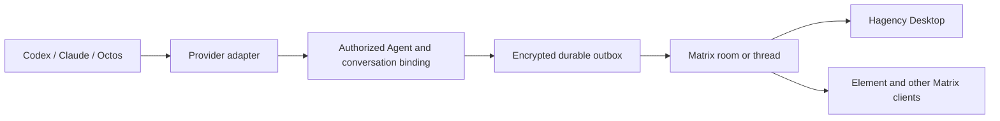

# ADR 0013: Spontaneous Agent messages in Matrix conversations

- Date: 2026-11-16
- Status: Accepted; implementation and end-to-end acceptance are pending.
- Scope: Hagency Desktop and its embedded Hagency Client, Hagency Server,
  provider adapters, and the Octos OUP protocol where an extension is needed.
  This record is the proposed cross-repository decision.
- Extends [ADR 0011](0011-hagency-server-engagements.md) and
  [ADR 0012](0012-owner-daemon-shared-dashboard.md). Existing Octos behavior is
  described in [Octos resources over OUP](../design/hagency-octos-oup.md).

## Context

Coding Agents need to send findings, progress, background results, and other
user-facing messages to a conversation without waiting for a new user prompt.
Each message must be a distinct chat message and must remain readable in
Hagency Desktop, Element, and other Matrix clients.

The existing implementation delivers some separate messages during an admitted
run: Codex root commentary, Claude intermediate messages, and Octos progress
tool calls and correlated OUP messages. The host records them in an encrypted
local outbox and sends them as Matrix messages. Streaming text also appears in
a run-card preview, which is not itself a durable message.

This is not yet complete autonomous delivery. Current routes and authorization
are tied to an admitted run; an Agent cannot generally originate an independent
report while idle. Shared Octos runs do not enable native background children.
The current outbox and the final-reply path also need a common identity rule
before a report can safely arrive after a foreground answer.

## Decision

Deliver every **explicitly user-facing** native message as its own Matrix room
message. This includes:

1. Progress emitted during a run.
2. A background result that arrives after the foreground answer.
3. An independent report from an authorized idle session or configured trigger.

The Agent must actually emit the message. Hagency must not manufacture a
report from private reasoning, arbitrary tool output, or internal child-Agent
transcripts. An explicitly user-facing child report may be delivered when its
provider and owner policy support it. The final answer remains a separate
message unless it is the same native message already delivered.

### Provider-neutral event contract

Adapters emit a completed, explicitly user-facing message with a provider
namespace, source session or instance ID, stable native message ID, kind,
content, optional attachment references, and optional originating run or task
ID. Kinds distinguish progress, background result, independent report, and final
answer. Their presentation labels do not change the Matrix message type.

The host, not the model or provider payload, attaches the authorized Agent,
owner, server, room, optional thread, binding ID, and binding generation.
The adapter may cite a host-issued scope, but cannot select an unapproved room
or replace the sender identity. Validate that the event belongs to the
supervised provider instance and its authorized session. Messages with an
unknown or ambiguous origin are held for diagnosis rather than guessed.

The deduplication identity is a namespaced native message identity scoped to
its Agent, provider session, and native turn, stream or task where the
provider's IDs require that scope. Different native IDs are different messages
even when their text is identical. A repeated identity with different content
is a protocol error, not an edit. For a provider without a stable ID, assign
and persist an ID at the capture boundary; this alone cannot deduplicate a
provider replay after a crash.

The existing final-reply ledger and this outbox must agree on the native
identity and resulting Matrix event, including across a crash between the two
records. If a previously emitted final answer is later followed by another
message, retain the earlier event and send the new one; do not send the
earlier answer a second time. Existing run IDs and transaction IDs remain
valid for already-recorded messages.

Attachments explicitly published as part of a report use the existing
authorized file-delivery and encryption path when available. Do not silently
discard an advertised attachment or expose an owner-local path; report an
unsupported or pending attachment state instead.

### Routing and authority

Persist a host-owned Agent–conversation route independent of any one run. A
run-related report retains the original room and thread. For a report without
a run, use an explicitly configured room and, if configured, thread. When an
Agent has several eligible destinations but no explicit route, leave the
message undelivered and show the owner how to resolve the destination.

Extend the existing Agent–room binding and server authorization contract as
needed to prove the current owner, Agent, room, binding generation, device and
send authority after the originating run ends. Recheck before each send,
including after restart. A revoked or changed binding is not authority to
reroute an old message to a new room. The local Agent device must still be a
permitted member with the necessary Matrix encryption keys and send power.

Separate permission to **deliver a captured message** from permission to
**continue or start work**. A background child retains the approved workspace,
provider, model, tool policy, cancellation authority and resource reservation.
Account for all of its usage before settling; retain unknown usage and
reservations as unknown. An independent scheduled or event-triggered turn
requires its own enabled trigger, admission and budget. This ADR does not
create schedules or grant indefinite execution merely by enabling delivery.
Stop, revocation, and binding-generation changes fence the corresponding work
and future sends. Avoid dispatching an Agent's own Matrix message back to the
same Agent as a fresh request.

### Delivery, ordering and recovery

Before acknowledging a report to the provider, durably commit its immutable
message and source identity to encrypted local storage. If the provider offers
a durable event cursor, checkpoint it in the same atomic journal transaction,
or use an equivalent recoverable protocol that cannot advance the cursor past
an unrecorded event. Apply backpressure or return an explicit error when
capacity is exhausted; do not silently drop a message.

Send messages in capture order per conversation. Derive a stable Matrix
transaction ID from the durable message identity and retain the resulting event
ID. A newly captured report also gets a persisted opaque report ID, included as
namespaced metadata inside the Matrix message content. It contains no provider
credentials, private path or native session identifier. Ordinary clients do
not need to interpret it.

For a lost response, retry the same transaction on the **same Matrix device and
endpoint**; Matrix transaction IDs are device- and endpoint-scoped. Refreshes
on the same device can retry, but device replacement or logout does not by
itself prove that reusing the ID will deduplicate. Reconcile through an
authoritative receipt or decryptable history containing the same opaque report
ID, expected Agent sender, room and content digest. If that evidence is
unavailable or conflicts, retain the unknown state instead of blindly sending
a second copy from a new device. See the
[Matrix transaction identifier specification](https://spec.matrix.org/v1.15/client-server-api/#transaction-identifiers).

On restart, recover pending messages without rerunning the model. Replay from a
provider cursor only where the supervised provider actually supports it.
Exactly-once capture cannot be promised for messages emitted while a provider
or listener was offline and has no durable replay. Surface that limitation in
capabilities and diagnostics. A queued receipt means local custody, not Matrix
delivery. Room revocation can permanently block a pending message; transient
connectivity failures remain retryable while authority is valid.

### Provider adapters

| Provider | Reuse | Additional work and qualification |
| --- | --- | --- |
| Codex | Existing app-server root commentary and message IDs. | Supervise the app-server event stream across the relevant session lifetime. Test which post-turn or idle events and replay operations the installed version actually supports. If a version cannot emit an independent report, advertise that limitation; a host-triggered turn must be labelled as such. |
| Claude | Existing completed assistant snapshots and correlated task notifications. | Preserve the exact session/task/run correlation when a background result follows the foreground answer. Verify stream lifetime and recovery using the real supported CLI; do not forward uncorrelated child text. |
| Octos | Existing OUP assistant segments, progress tool and correlated `background/spawn_complete` event. | Keep eligible background events observable and use durable cursors where the scoped runtime supports replay. Add and negotiate a versioned OUP Agent-report event for reports without a parent turn. Enable shared background children only after isolation, admission, cancellation and usage accounting are implemented and tested. |

Negotiate independent-report and replay support per provider **and version**;
do not infer support merely because an Agent is configured. The common contract
can later accept Pi, Hermes, OpenCode or other adapters without requiring those
integrations in this ADR's first release.

### Matrix and Desktop presentation

Send each report from the Agent's Matrix account as a standard
`m.room.message` with `m.text` and a complete plain-text body. Include
standards-compatible formatted HTML where available. Use the standard
`m.thread` relation and a compatible reply fallback for a thread-bound report.
The namespaced report ID is required for new Hagency sends, but ordinary
clients must not need to interpret it to read the message. In encrypted
rooms, message content is end-to-end encrypted using the Agent device; room
and relationship metadata follow Matrix's normal visibility rules.
Unencrypted rooms retain their normal plaintext behavior.

Desktop renders each event as its own message with the Agent's sender identity,
Markdown, unread behavior and normal copy/reply actions. Determine an Agent
from a verified local/server identity mapping rather than only an account-name
prefix; an unrecognized sender still renders as an ordinary Matrix message.
Thread-bound reports appear in the original thread. Provide an accessible
room-level indication that opens the thread, without creating a duplicate
message. The Agent management surface can show queued, retrying, blocked and
unknown delivery states and link to the relevant conversation.

Other Matrix clients need only render the standard message and thread relation.
Hagency-specific run controls or management surfaces are optional and must not
be required to read a report. Element's key availability, thread presentation
and notifications remain subject to its own client and homeserver behavior.

## Alternatives considered

- **Edit one run card or append to the final answer:** loses individual message
  identity and makes later background reports difficult to find.
- **Keep a completed run's authority indefinitely:** couples delivery to a
  stale lease and can accidentally preserve execution or budget authority.
- **Send a Hagency-only Matrix event:** makes reports unreadable in Element and
  clients that do not implement the custom event.
- **Infer a destination from the most recent room:** can send a report to the
  wrong project or thread when an Agent participates in multiple rooms.

## Implementation and rollout

1. Add the common event identity, durable capture, route and recovery
   contracts in Hagency Client/Desktop. Extend Hagency Server's existing
   binding and authorization APIs where required. Use additive schema and
   protocol changes; keep current run-bound delivery working.
2. Add Codex and Claude listeners and capability qualification. Implement the
   Octos OUP extension upstream and consume its negotiated events. Land Octos
   shared-background execution separately behind its isolation and accounting
   gates. Providers without independent reports keep their current behavior.
3. Add Desktop identity mapping, delivery status and thread navigation. Keep
   all message bodies usable by ordinary Matrix clients.
4. Roll out compatible server changes before enabling new host capabilities.
   Preserve v1 outbox records and their original transaction IDs. A downgrade
   must not discard or blindly resend v2 records: drain them or retain them
   for a compatible host, and document any unresolved delivery state.

## Acceptance

- For each provider, deterministic fixtures cover multiple messages in one
  run, a message after the foreground answer, and an independent idle event
  where the provider claims support. Distinct native messages with equal text
  remain distinct; replay of the same message creates no second Matrix event.
- Tests cover concurrent rooms and threads, sender identity, correct ordering
  per conversation, ambiguous routes, revoked bindings, stop/cancellation,
  exhausted capacity, unknown usage, unsupported capabilities and non-text
  attachments. No private child text becomes a user-facing message by default.
- Crash tests cover provider capture, cursor checkpoint, send response loss,
  final-reply settlement, restart, access-token refresh and device replacement.
  A replacement device reconciles a verifiable original event and must not
  turn an unknown prior send into an unverified duplicate.
- Use an isolated encrypted Matrix room and a synthetic model to verify actual
  event delivery, decryption and final-answer coexistence. Add real CLI smoke
  coverage for Codex, Claude and Octos, and record unsupported cases explicitly.
- In a separate worktree, run headless Hagency JIT UI checks with isolated
  Desktop and owner-daemon data. Verify separate rows, Markdown, a sender with
  a nonstandard Agent ID, unread/thread navigation and retry status. Respect
  the shared-machine one-JIT rule without stopping existing user processes.
- Verify the same encrypted text and thread messages in Element. Test
  notifications and key availability separately; client-specific run controls
  are not a prerequisite for reading the message.
- Run the repository's budget and chat regression gate before promoting a
  build. Record source revisions, provider versions and live-test evidence;
  fixtures alone do not prove live interoperability.
