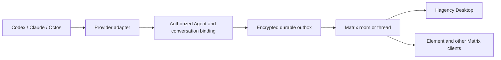

# ADR 0013: Spontaneous Agent messages in Matrix conversations

- Date: 2026-11-16
- Amended: 2026-11-17. A replacement device may send a report once when the
  room's history proves it never arrived. It reads what the Agent's earlier
  devices on the same computer sent with those devices' own stores (see
  "Delivery, ordering and recovery").
- Status: Accepted; implementation and end-to-end acceptance are pending.
- Scope: Hagency Desktop and its embedded Hagency Client, Hagency Server,
  provider adapters, and the Octos OUP protocol where an extension is needed.
  This record is the proposed cross-repository decision.
- Extends [ADR 0011](0011-hagency-server-engagements.md) and
  [ADR 0012](0012-owner-daemon-shared-dashboard.md). Existing Octos behavior is
  described in [Octos resources over OUP](../design/hagency-octos-oup.md).

## Context

Coding Agents need to send findings, progress, background results, and other
user-facing messages to a conversation without waiting for a new user prompt.
Each message must be a distinct chat message and must remain readable in
Hagency Desktop, Element, and other Matrix clients.

The existing implementation delivers some separate messages during an admitted
run: Codex root commentary, Claude intermediate messages, and Octos progress
tool calls and correlated OUP messages. The host records them in an encrypted
local outbox and sends them as Matrix messages. Streaming text also appears in
a run-card preview, which is not itself a durable message.

This is not yet complete autonomous delivery. Current routes and authorization
are tied to an admitted run; an Agent cannot generally originate an independent
report while idle. Shared Octos runs do not enable native background children.
The current outbox and the final-reply path also need a common identity rule
before a report can safely arrive after a foreground answer.

## Decision

Deliver every **explicitly user-facing** native message as its own Matrix room
message. This includes:

1. Progress emitted during a run.
2. A background result that arrives after the foreground answer.
3. An independent report from an authorized idle session or configured trigger.

The Agent must actually emit the message. Hagency must not manufacture a
report from private reasoning, arbitrary tool output, or internal child-Agent
transcripts. An explicitly user-facing child report may be delivered when its
provider and owner policy support it. The final answer remains a separate
message unless it is the same native message already delivered.

### Provider-neutral event contract

Adapters emit a completed, explicitly user-facing message with a provider
namespace, source session or instance ID, stable native message ID, kind,
content, optional attachment references, and optional originating run or task
ID. Kinds distinguish progress, background result, independent report, and final
answer. Their presentation labels do not change the Matrix message type.

The host, not the model or provider payload, attaches the authorized Agent,
owner, server, room, optional thread, binding ID, and binding generation.
The adapter may cite a host-issued scope, but cannot select an unapproved room
or replace the sender identity. Validate that the event belongs to the
supervised provider instance and its authorized session. Messages with an
unknown or ambiguous origin are held for diagnosis rather than guessed.

The deduplication identity is a namespaced native message identity scoped to
its Agent, provider session, and native turn, stream or task where the
provider's IDs require that scope. Different native IDs are different messages
even when their text is identical. A repeated identity with different content
is a protocol error, not an edit. For a provider without a stable ID, assign
and persist an ID at the capture boundary; this alone cannot deduplicate a
provider replay after a crash.

The existing final-reply ledger and this outbox must agree on the native
identity and resulting Matrix event, including across a crash between the two
records. If a previously emitted final answer is later followed by another
message, retain the earlier event and send the new one; do not send the
earlier answer a second time. Existing run IDs and transaction IDs remain
valid for already-recorded messages.

Attachments explicitly published as part of a report use the existing
authorized file-delivery and encryption path when available. Do not silently
discard an advertised attachment or expose an owner-local path; report an
unsupported or pending attachment state instead.

### Routing and authority

Persist a host-owned Agent–conversation route independent of any one run. A
run-related report retains the original room and thread. For a report without
a run, use an explicitly configured room and, if configured, thread. When an
Agent has several eligible destinations but no explicit route, leave the
message undelivered and show the owner how to resolve the destination.

Extend the existing Agent–room binding and server authorization contract as
needed to prove the current owner, Agent, room, binding generation, device and
send authority after the originating run ends. Recheck before each send,
including after restart. A revoked or changed binding is not authority to
reroute an old message to a new room. The local Agent device must still be a
permitted member with the necessary Matrix encryption keys and send power.

Separate permission to **deliver a captured message** from permission to
**continue or start work**. A background child retains the approved workspace,
provider, model, tool policy, cancellation authority and resource reservation.
Account for all of its usage before settling; retain unknown usage and
reservations as unknown. An independent scheduled or event-triggered turn
requires its own enabled trigger, admission and budget. This ADR does not
create schedules or grant indefinite execution merely by enabling delivery.
Stop, revocation, and binding-generation changes fence the corresponding work
and future sends. Avoid dispatching an Agent's own Matrix message back to the
same Agent as a fresh request.

### Delivery, ordering and recovery

Before acknowledging a report to the provider, durably commit its immutable
message and source identity to encrypted local storage. If the provider offers
a durable event cursor, checkpoint it in the same atomic journal transaction,
or use an equivalent recoverable protocol that cannot advance the cursor past
an unrecorded event. Apply backpressure or return an explicit error when
capacity is exhausted; do not silently drop a message.

Send messages in capture order per conversation. Derive a stable Matrix
transaction ID from the durable message identity and retain the resulting event
ID. A newly captured report also gets a persisted opaque report ID, included as
namespaced metadata inside the Matrix message content. It contains no provider
credentials, private path or native session identifier. Ordinary clients do
not need to interpret it.

For a lost response, retry the same transaction on the **same Matrix device and
endpoint**; Matrix transaction IDs are device- and endpoint-scoped. Refreshes
on the same device can retry, but device replacement or logout does not by
itself prove that reusing the ID will deduplicate. Reconcile through an
authoritative receipt or decryptable history containing the same opaque report
ID, expected Agent sender, room and content digest. A replacement device may
send the report once only when that history proves the report absent, and only
if all of these hold:
- The history reaches back past the first attempt: an event from the sender's
  own homeserver older than the first attempt minus a clock margin (one hour).
- Every event from the expected sender in it is readable and authentic.
- None of those events carries the report.
- The last attempt has been quiet for a settle period (five minutes).
- The sender account is unchanged.
- The report is not resent in plaintext after an encrypted first attempt.

A replacement device cannot decrypt its predecessors' messages with its own
keys. Each device generation keeps its own crypto store in the Agent's private
directory on that computer, so the check reads the expected sender's
undecryptable events with those stores. It uses only a session that the
earlier device started itself, never one it received, imported or restored.
The Megolm signature and the room must both verify. Nothing is imported into
the new device's store. Messages from the Agent's devices on other computers
stay unreadable.

If that evidence is unavailable, incomplete or conflicts, retain the unknown
state instead of blindly sending a second copy from a new device. See the
[Matrix transaction identifier specification](https://spec.matrix.org/v1.15/client-server-api/#transaction-identifiers).

On restart, recover pending messages without rerunning the model. Replay from a
provider cursor only where the supervised provider actually supports it.
Exactly-once capture cannot be promised for messages emitted while a provider
or listener was offline and has no durable replay. Surface that limitation in
capabilities and diagnostics. A queued receipt means local custody, not Matrix
delivery. Room revocation can permanently block a pending message; transient
connectivity failures remain retryable while authority is valid.

### Provider adapters

| Provider | Reuse | Additional work and qualification |
| --- | --- | --- |
| Codex | Existing app-server root commentary and message IDs. | Supervise the app-server event stream across the relevant session lifetime. Test which post-turn or idle events and replay operations the installed version actually supports. If a version cannot emit an independent report, advertise that limitation; a host-triggered turn must be labelled as such. |
| Claude | Existing completed assistant snapshots and correlated task notifications. | Preserve the exact session/task/run correlation when a background result follows the foreground answer. Verify stream lifetime and recovery using the real supported CLI; do not forward uncorrelated child text. |
| Octos | Existing OUP assistant segments, progress tool and correlated `background/spawn_complete` event. | Keep eligible background events observable and use durable cursors where the scoped runtime supports replay. Add and negotiate a versioned OUP Agent-report event for reports without a parent turn. Enable shared background children only after isolation, admission, cancellation and usage accounting are implemented and tested. |

Negotiate independent-report and replay support per provider **and version**;
do not infer support merely because an Agent is configured. The common contract
can later accept Pi, Hermes, OpenCode or other adapters without requiring those
integrations in this ADR's first release.

### Matrix and Desktop presentation

Send each report from the Agent's Matrix account as a standard
`m.room.message` with `m.text` and a complete plain-text body. Include
standards-compatible formatted HTML where available. Use the standard
`m.thread` relation and a compatible reply fallback for a thread-bound report.
The namespaced report ID is required for new Hagency sends, but ordinary
clients must not need to interpret it to read the message. In encrypted
rooms, message content is end-to-end encrypted using the Agent device; room
and relationship metadata follow Matrix's normal visibility rules.
Unencrypted rooms retain their normal plaintext behavior.

Desktop renders each event as its own message with the Agent's sender identity,
Markdown, unread behavior and normal copy/reply actions. Determine an Agent
from a verified local/server identity mapping rather than only an account-name
prefix; an unrecognized sender still renders as an ordinary Matrix message.
Thread-bound reports appear in the original thread. Provide an accessible
room-level indication that opens the thread, without creating a duplicate
message. The Agent management surface can show queued, retrying, blocked and
unknown delivery states and link to the relevant conversation.

Other Matrix clients need only render the standard message and thread relation.
Hagency-specific run controls or management surfaces are optional and must not
be required to read a report. Element's key availability, thread presentation
and notifications remain subject to its own client and homeserver behavior.

## Alternatives considered

- **Edit one run card or append to the final answer:** loses individual message
  identity and makes later background reports difficult to find.
- **Keep a completed run's authority indefinitely:** couples delivery to a
  stale lease and can accidentally preserve execution or budget authority.
- **Send a Hagency-only Matrix event:** makes reports unreadable in Element and
  clients that do not implement the custom event.
- **Infer a destination from the most recent room:** can send a report to the
  wrong project or thread when an Agent participates in multiple rooms.

## Implementation and rollout

1. Add the common event identity, durable capture, route and recovery
   contracts in Hagency Client/Desktop. Extend Hagency Server's existing
   binding and authorization APIs where required. Use additive schema and
   protocol changes; keep current run-bound delivery working.
2. Add Codex and Claude listeners and capability qualification. Implement the
   Octos OUP extension upstream and consume its negotiated events. Land Octos
   shared-background execution separately behind its isolation and accounting
   gates. Providers without independent reports keep their current behavior.
3. Add Desktop identity mapping, delivery status and thread navigation. Keep
   all message bodies usable by ordinary Matrix clients.
4. Roll out compatible server changes before enabling new host capabilities.
   Preserve v1 outbox records and their original transaction IDs. A downgrade
   must not discard or blindly resend v2 records: drain them or retain them
   for a compatible host, and document any unresolved delivery state.

## Acceptance

- For each provider, deterministic fixtures cover multiple messages in one
  run, a message after the foreground answer, and an independent idle event
  where the provider claims support. Distinct native messages with equal text
  remain distinct; replay of the same message creates no second Matrix event.
- Tests cover concurrent rooms and threads, sender identity, correct ordering
  per conversation, ambiguous routes, revoked bindings, stop/cancellation,
  exhausted capacity, unknown usage, unsupported capabilities and non-text
  attachments. No private child text becomes a user-facing message by default.
- Crash tests cover provider capture, cursor checkpoint, send response loss,
  final-reply settlement, restart, access-token refresh and device replacement.
  A replacement device reconciles a verifiable original event. It resends only
  after the room's history proves the report absent, and must not turn an
  unknown prior send into an unverified duplicate.
- Use an isolated encrypted Matrix room and a synthetic model to verify actual
  event delivery, decryption and final-answer coexistence. Add real CLI smoke
  coverage for Codex, Claude and Octos, and record unsupported cases explicitly.
- In a separate worktree, run headless Hagency JIT UI checks with isolated
  Desktop and owner-daemon data. Verify separate rows, Markdown, a sender with
  a nonstandard Agent ID, unread/thread navigation and retry status. Respect
  the shared-machine one-JIT rule without stopping existing user processes.
- Verify the same encrypted text and thread messages in Element. Test
  notifications and key availability separately; client-specific run controls
  are not a prerequisite for reading the message.
- Run the repository's budget and chat regression gate before promoting a
  build. Record source revisions, provider versions and live-test evidence;
  fixtures alone do not prove live interoperability.

## First implementation of an idle session's own turn (2026-11-17)

This section records what is built for item 3 of the decision ("an
independent report from an authorized idle session") and where it stops short
of the rules above. It covers local Claude Agents only. Codex, Octos and
pooled Agents are unchanged.

**What starts such a turn.** A retained Claude Code process starts a turn by
itself when a timer the session set fires (`ScheduleWakeup`) or when another
Claude session on the same computer, under the same user, sends it a message.
Nothing is written to the process for it. Measured on Claude Code 2.1.323: the
stream shows `session_state_changed running`, `command_lifecycle started`
(with `wakeup_source: loop_wakeup` for a timer), `init`, the turn, and a
`result` that names no user message. A timer's result has no `origin`; a peer
message's result has `origin.kind = "peer"`. Any other origin is refused.

**How the host sees it.** The run loop of each binding looks at its parked
sessions once per pass, without waiting and without writing. Idle metadata is
passed over; the first frame of a turn makes the session leave the cache with
that turn open; any other frame ends the process, as the reuse check of its
next request did before. The look runs before the next request is taken.

**Route.** A retained session belongs to one conversation: its key holds the
Agent, binding, room, requester and thread. Its own turn reports to the room
and thread of the run that session answered last. This is the session's own
conversation, not "the most recent room of the Agent", so the rule against
inferring a destination is kept. An Agent-level report with no session behind
it still needs the configured route this ADR describes; that is not built.

**Admission and budget.** The turn already runs inside the CLI when the host
sees it, so admission decides whether the host lets it continue. It continues
a conversation that was already admitted, and nobody is asked for it. It is
charged and settled in the local ledger as a call of its own
(`self-started-<random>`), under the session's scope. Where the scope's
requests need the owner's confirmation, the host records that confirmation
for this turn itself; the next request is asked for as before. Three things
still refuse it: a scope whose requests are denied, a spent budget, and
hosting that is closed. A refused turn is charged nothing and its process is
stopped; the conversation resumes from disk with the next request. Tool
requests inside the turn follow the saved tool rules and are shown on the
message the session answered last.

**No approval for the timer.** `ScheduleWakeup` only sets a timer for the
session's own later turn. It does nothing on the owner's computer and reaches
nobody, so a local Agent's host allows it without consulting the tool rules,
whatever they say. The same holds for the CLI's schedules of the same session
(`CronCreate`, `CronList`, `CronDelete`), and for loading the description of
one of these tools: the CLI may offer them by name only, and the model then
looks one up (`ToolSearch` with `select:` and nothing but timer tools) before
it can set a timer. `SendMessage` stays under the tool rules: it reaches
another session, and so does every other lookup.

**Messages from peer sessions are delivered.** Claude Code holds a message
from a session that runs in another permission mode until a person releases
it (`system peer_message_hold`, cause `mode-mismatch`; measured on 2.1.323).
The owner's interactive sessions usually run in another mode than a local
Agent's headless one, and a headless session has nobody to release anything,
so every such message was held and later dropped. A local Agent's CLI is
therefore started with `crossSessionInbound: "accept"`. A message that
arrives while the session runs a turn is taken into that turn by the CLI and
answered with it. A hold or drop notice that still arrives is idle metadata:
nothing ran for it, and the session stays. Pooled runs do not get the
setting.

**A peer message does not carry the room's trust.** Its text comes from
outside the conversation, from any Claude session of the same user on the
computer, whatever that session was told or has read. The host tells it
apart from the frames alone: the CLI reports every input as a command, the
prompt and added instructions under the identifiers the host gave them, a
timer with its `wakeup_source`, and a finished background task not as a
command at all. A command that is neither the host's nor a timer's is a peer
message, whether it starts a turn or is taken into a running one. From that
frame to the end of the turn, saved tool rules and the owner's full trust
answer for nothing: every tool the rules would allow is put to the owner,
the timer tools included, because a timer set in such a turn would later run
as the session's own. A denying rule still denies.

What is not shown to be the session's own counts as outside, because the CLI
updates itself and a later version may report a peer message differently. A
turn the CLI starts while the session is parked is the session's own only
where a timer was reported started for it; a turn with no command frame, a
command in a state no capture has shown, a command without a name, and a
further cycle that follows a timer's without a timer of its own are all
treated like a peer message. Only the end of a command is passed over. A
session is not parked while a background task of a turn is still running, so
a turn without a command frame is never a background result. The cost of
this rule is an owner who is asked once too often.

The owner is told where such a request comes from. Its proposal carries the
risk `peer_session`, and the approval card and the request list say that the
request follows a message from another Claude session on this computer and
not from this chat. A card that looks like the chat's own request would be
approved as one.

Three things this does not close. Text the message left in the conversation
is read by later turns like any other history; the host cannot separate
that. A timer the owner approves inside such a turn later fires as a timer
of the session, and a background job approved there reports inside the same
turn; both then act with the peer's text in context. And a pooled run: its
CLI is not started with the setting, so a message is delivered to it only
from a session in the same permission mode; whether such a session can reach
a pooled run was not measured, and the pooled host does not look at where
input came from. Whether a peer turn should run under the owner's trust
instead is the owner's decision and is open.

**A note to the model.** A model asked to do something later tends to wait
inside the turn with a `sleep` command. That asks the owner for a command
and keeps the Agent busy for the whole wait. A local Agent's CLI therefore
gets one added instruction (`--append-system-prompt`): to do something later
or to report on a schedule, set a timer and end the answer; the later answer
is posted to the same chat by itself. The instruction names the host's own
timer tool first (see "Timers kept by the host") and leaves `ScheduleWakeup`
for when it is asked for by name.

**Decided on 2026-11-17: no separate switch.** The rules above ask for "its
own enabled trigger" for an independent turn. For a local Agent that rule is
set aside: its own turn needs no approval and no switch of its own. A timer
exists only because an admitted run set it, and a peer message can only come
from the owner's own computer and user. What bounds such a turn is the
budget, a denying request rule, and stopping the Agent or its hosting.

**Delivery.** Every message of the turn, its final answer included, is
recorded as a version-2 report (`self-started:<turn>:<native id>`) in the
encrypted outbox of the run the session answered last and sent with
delivery-only authority, as described under "Delivery, ordering and
recovery". A sealed note beside the outbox names each run that may hold such
reports, so delivery resumes after a restart; no turn the CLI started by
itself is run again. The turn of a timer the host keeps is the one exception
(see "Timers kept by the host").

**Limits of this version.**

- A turn that starts between the look and the reuse check of a new request
  still ends its session; its output is lost and the request starts a fresh
  process.
- A self-started cycle that follows a requested turn's result without an idle
  state in between still ends that requested turn as a late failure.
- The room's history and file tools answer "unavailable" in such a turn (the
  timer tools work), questions to the requester go unanswered, and the room
  cannot steer or stop it.
- Stopping the process (refusal, eviction from the cache of 8 sessions, daemon
  restart) ends the timers the CLI keeps itself (`ScheduleWakeup`, cron). A
  timer set with the host is not affected.
- A turn that a restart cuts off says nothing about it in the room: what it
  had already sent stays, its answer never comes. Only the turn of a host
  timer is started again.
- A host that predates version-2 records cannot read an outbox that holds one
  (see rollout step 4).

**Evidence.** Driver and local-runtime tests with the captured frames; the
installed CLI against a localhost model (timer fires while parked, the turn is
taken over, admitted, charged and settled, the next request continues the
session); live runs on River on 2026-11-17 with local Claude Agents: in a
private chat that is not encrypted (reply, then the report as its own message
about two minutes later, then a further request answered by the same
process), and in an encrypted room of an Agent space (the report arrived in
the thread of the message that set the timer, readable by the owner's
client). In that room also: a reminder asked for in plain words was set with
the timer tool and arrived a minute later, and a message another Claude
session on the computer sent to the parked session was answered in the same
thread.

## Timers kept by the host (2026-11-17)

**Why.** A timer of Claude Code lives in the process that set it. A restart of
the host, the eviction of the idle session and a refused turn end it without
a word, and Codex and Octos have no such tool. Seen live: the host was
restarted in the middle of a timer's turn; nothing was posted for it, nothing
was posted twice, and the timer was gone.

**Tools.** A local Agent of any of the three runtimes gets three more room
tools (`RoomTools::with_timers()`): `schedule_wakeup {delay_seconds, note,
repeat_seconds?}`, `list_wakeups {}` and `cancel_wakeup {wakeup_id}`. The
model never names a room: a timer belongs to the conversation (room and
thread) of the run that set it, and list and cancel see only that
conversation's timers. The delay is 10 seconds to 30 days, a repeat interval
at least 60 seconds, the note at most 2000 bytes, and a conversation holds at
most 8 timers. A call that cannot be used is answered with the reason, not
with "unavailable". A pooled run is not offered these tools: a pool member's
timer would spend the pool with nobody asking, which needs an admission by
the server first.

**Store.** One sealed file per timer under `outgoing-messages/timers/` of the
Agent's device, with the key of the outbox: its id, the run it was set in,
room and thread, whether that run's request came as ciphertext, due time,
note, repeat interval, and how often it started and ran. Outbox recovery
reads only `run_*` entries, so a host that does not know the folder leaves it
alone.

**Encrypted or not.** Every send path reads "this request came as ciphertext"
from the request record: an empty body. The ledger's record of a run gives up
its body once the answer is proved sent, so a record read back later looks
encrypted whatever it was, and a report for a chat that is not encrypted was
held back for good (seen live with a timer in such a chat; the same held back
the reports a restart found). The fact is therefore written down while the
body is still there, in the timer and in the note of undelivered reports, and
put back on the record when it is read from the ledger. A timer or note from
before that is read as encrypted: its reports go out encrypted or not at all.

**Firing.** The loop of each binding looks at the timers every two seconds.
For one that is due it checks that the run it was set in is still this
binding's and that the scope does not deny requests; while hosting is closed
the timer waits. It then counts the attempt on disk, takes the
conversation's idle process or starts one that resumes the conversation from
disk exactly as a request would (the same checks, working folder and tools),
and gives the model the host's own words: a timer it set is due, its note,
and that the answer is posted as its own message. From there the turn is a
self-started turn as above: admitted without asking, refused by a denying
scope or a spent budget, charged and settled as a turn of its own, its
messages delivered to the room and thread of the run that set the timer, a
tool the rules ask about put to the owner.

**At least once.** This is where a host timer differs from a turn the CLI
started. A timer's turn that a restart cut off is started once more; after
two cut-off starts that due time is given up (a repeating timer waits for its
next time, any other is removed). The second start tells the model that the
earlier turn was cut off and that nothing it answered reached the chat, and
asks it to check what was already done before repeating a command or a
change. Part of a timer's work can therefore run twice. That is chosen over a
reminder that silently never comes.

**Repeating.** The next time counts from the end of the turn, so a host that
was off for a day does not run the missed turns one after another. A
repeating timer ends by itself after 200 runs or seven days. The Agent can
remove it in the timer's own turn: the host reads the timer again after the
turn and leaves it alone if it is gone.

**A model that waits instead.** Asked for a reminder half a minute away, a
Codex Agent waited inside its turn and answered then; no timer was set. That
is its choice and nothing is lost by it, but the Agent is busy for the wait.
Only Claude's CLI gets the added instruction above; the other two learn of
the timer from the tool's description.

**Trust.** In an ordinary turn the three tools need nobody's approval, for
the reason given under "No approval for the timer". In a turn that holds a
message of a peer session, setting and removing a timer are put to the owner
like every other tool of that turn, so a peer cannot leave a timer behind
unseen. The turn a timer starts is the conversation's own turn and runs under
the rules of the scope the timer was set in.

**The CLI's own timers stay.** `ScheduleWakeup` and the cron tools of Claude
Code are not taken away. `permissions.deny` in the settings given to the CLI
removes them from the model's tools (measured with 2.1.323); doing that is
left for later.

**Codex 0.169.** The live check found that every room tool of a local Codex
Agent answered "unavailable" with Codex 0.169: the bridge compared the call's
item id with its call id, which were equal in 0.167 and are not in 0.169
(measured with the installed CLI). The comparison is gone; a call is still
bound to a turn observed on the process's own stream and its call id is
accepted once.

**Evidence.** Unit tests of the tools, the store and the repeat and give-up
rules; local-runtime tests of a host-started turn for Claude and Octos
(admitted without asking, refused by a denying scope and a spent budget);
the bridge test with the 0.169 call shape. Live on River on 2026-11-17, in an
encrypted room of an Agent space: a local Claude Agent set a reminder in
plain words and it arrived; a timer set before a restart of the host fired
one second late after it, in a process started for it; a repeating timer ran
twice, was removed by the Agent in its second turn and did not run again; a
local Codex Agent set a timer and its report arrived. In a private chat that
is not encrypted: a local Octos Agent set a timer and its report arrived.
The host was restarted while a timer's turn ran a command the owner had
approved: the turn started again 83 seconds late in a new process, asked for
the command again, said in its report that the earlier run had been cut off,
and the room got one report. Not run live: a timer set in a turn that holds
a peer session's message.
